 

---

## About me

I'm **Abi Sugesh**, a full-stack developer who enjoys turning product ideas into polished, maintainable web experiences. I care about thoughtful interfaces, reliable backends, and the details that make software feel effortless.

- **Building:** Squares, Abi-Sugesh, and WavesandMist
- **Working with:** Java, Spring Boot, React, Next.js, and TypeScript
- **Interested in:** Full-stack development, product design, and practical problem-solving
- **Available for:** Interesting collaborations and opportunities

---

## My toolkit

**Frontend & UI**

**Backend & data**

**Tools**

---

## Selected projects

 

<a href="https://abisugesh.in/">Explore more work on my portfolio</a>

---

## GitHub at a glance

---

## Contribution activity

<picture>
  <source media="(prefers-color-scheme: dark)" srcset="https://raw.githubusercontent.com/Abiisugesh/Abiisugesh/output/github-contribution-grid-snake-dark.svg" />
  <source media="(prefers-color-scheme: light)" srcset="https://raw.githubusercontent.com/Abiisugesh/Abiisugesh/output/github-contribution-grid-snake.svg" />
  
</picture>

---

