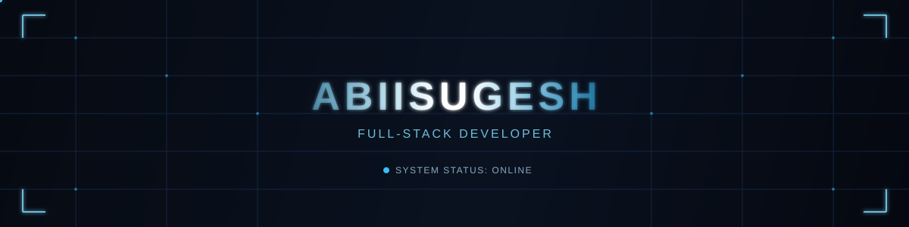

 

 

## About

I'm a full-stack developer focused on building clean, maintainable web applications. I enjoy working across the stack — from designing intuitive interfaces to building the systems that power them.

- 🚀 Currently building **Squares**, **Abi-Sugesh**, and **WavesandMist**
- 🧠 Comfortable with JavaScript, TypeScript, and modern front-end frameworks
- 🎯 I care about clean code, thoughtful UI, and getting the details right
- 📬 Open to opportunities and collaboration — reach out anytime

 

## Tech Stack

 

## GitHub Stats

 

## Contribution Activity

<!--START_SECTION:activity-->

<!--END_SECTION:activity-->

 

## Featured Projects

 

